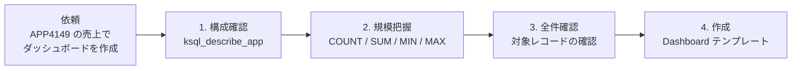
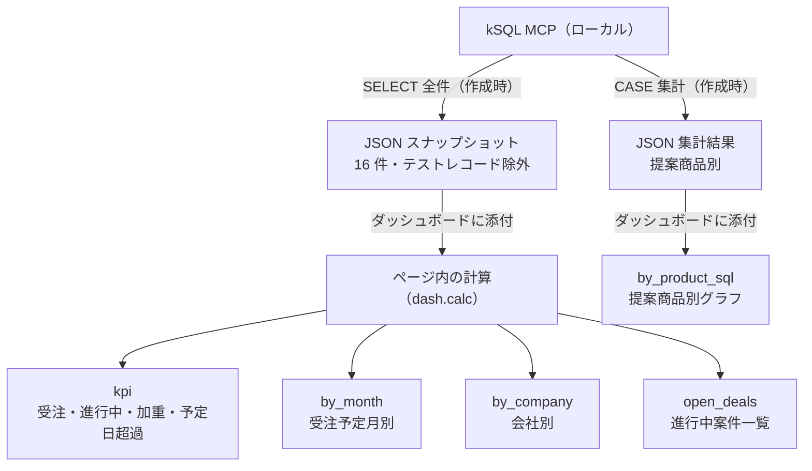
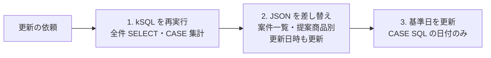

<!--- TITLE: kSQL + Claude Dashboards で kintone の売上ダッシュボードを会話だけで作る --->

> **結論（3 行）**
>
> - Claude Dashboards は「データに関する質問 → クエリ → ダッシュボード」を会話だけで作る機能で、kSQL MCP と組み合わせると kintone アプリでもそのまま使えます
> - ただし kSQL MCP はローカル MCP なので、今回は**ライブ接続ではなく「kSQL で取得した結果を添付 + ページ内計算」**という構成にしました
> - 横持ちの集計も kSQL の `CASE` で SQL 側に寄せられ、ダッシュボードの数値と突き合わせて確認できます


## はじめに

Claude に「Claude Dashboards」という機能が加わりました。
公式ヘルプでは次のように説明されています（2026-10 時点、ベータ）。

- データウェアハウス（BigQuery、Snowflake、Redshift など）や接続済みのアプリを接続し、自然言語で質問すると、Claude がクエリを書いてダッシュボードを組み立てる
- ダッシュボードは Dashboards テンプレートから作られるアーティファクトで、各チャートは自分のクエリと最終更新時刻を表示する
- Pro / Max / Team / Enterprise で利用可能（Enterprise は管理者が有効化するまでオフ）

公式の例はデータウェアハウスや Salesforce ですが、
kintone も **kSQL MCP サーバー**経由なら「SQL で問い合わせできるデータソース」として扱えます。
本記事では、kintone の案件管理アプリ（APP4149）を題材に、
会話だけで売上ダッシュボードを作った過程と、そこで分かった制約をまとめます。

kSQL（[`kintone-sql-tools`](https://github.com/rex0220/kintone-sql-tools)）は、
kintone アプリを SQL 風の構文で扱うためのツールセットで、MCP サーバーとして Claude から使えます。
REST API を直接ツール化する方式と比べた利点は、[AIエージェントにkintoneを操作させるにはSQLが最適解である](https://qiita.com/rex0220/items/fbed33b11251cdf7e31e) で詳しく書いています。

## 環境

| 項目 | 内容 |
| --- | --- |
| Claude | claude.ai（Dashboards 利用可能なプラン） |
| kintone 接続 | kSQL MCP サーバー（Claude デスクトップアプリ経由のローカル MCP） |
| 対象アプリ | APP4149（案件管理、20 レコード） |

事前に、Claude デスクトップアプリへ kSQL MCP サーバーを導入し、Claude から `ksql_describe_app` などのツールを呼べる状態にしておきます。
導入手順は [kSQL MCPB Claude Desktop インストール手順](https://github.com/rex0220/kintone-sql-tools/blob/main/docs/ksql_mcpb_claude_desktop_install.md) を参照してください。

## やったこと：依頼は 1 行

Claude への依頼はこれだけです。

```text
APP4149 の売上でダッシュボードを作成
```


ここから先、Claude が実際に行ったのは次の 4 ステップでした。

1. `ksql_describe_app` でアプリのフィールド構成を確認
2. 件数と売上合計を集計して規模を把握
3. 件数が小さいので全件を取得し、中身を確認
4. Dashboard テンプレートからダッシュボードを作成



### 1. フィールド構成の確認

`DESCRIBE` 相当の結果から、ダッシュボードに使うフィールドを決めています。

| フィールドコード | タイプ | 用途 |
| --- | --- | --- |
| `売上` | NUMBER | 金額 |
| `商談フェーズ` | DROP_DOWN | 受注 / 提案中 / 内示 |
| `確度` | DROP_DOWN | 加重見込みの計算（`60%` などの文字列） |
| `提案商品` | DROP_DOWN | 商品別内訳 |
| `会社名` | SINGLE_LINE_TEXT | 会社別内訳 |
| `受注予定日` | DATE | 月別推移・予定日超過の判定 |

`主担当`（ユーザー選択）も取れますが、人名は依頼に含まれていないため載せていません。

### 2. 規模の把握

```sql
SELECT COUNT(*) AS 件数, SUM(売上) AS 売上合計,
       MIN(受注予定日) AS 最小予定日, MAX(受注予定日) AS 最大予定日
FROM APP4149
```

| 件数 | 売上合計 | 最小予定日 | 最大予定日 |
| --- | --- | --- | --- |
| 20 | 81800000 | （空） | 2026-10-26 |

`最小予定日` が空になっています。
標準 SQL の `MIN()` は NULL を無視しますが、kSQL では kintone の未入力の DATE が空文字として返り、`MIN` / `MAX` は空セルも比較の候補に含めます（言語リファレンス §8）。
そのため、未入力のレコードが 1 件でもあると `MIN` は空になります。

未入力の件数と、未入力を除いた最小日付は、次のように明示して確認できます。

```sql
SELECT COUNT(*) AS 全件, COUNT(受注予定日) AS 予定日あり FROM APP4149;
SELECT MIN(受注予定日) AS 最小予定日 FROM APP4149 WHERE 受注予定日 IS NOT NULL;
```

| 全件 | 予定日あり | 最小予定日（未入力を除く） |
| --- | --- | --- |
| 20 | 16 | 2026-02-11 |

未入力が 4 件あり、件数も少ないため、全件を確認しました。

### 3. 全件確認

```sql
SELECT 案件No_, 案件名, 会社名, 売上, 商談フェーズ, 確度, 提案商品, 受注予定日
FROM APP4149 ORDER BY 案件No_
```

> **注**：No.338〜341 は商談フェーズ・確度・受注予定日が空で、売上も 空 / 0 / -1 / 1 のテストレコードだったため、集計対象から除外しています。
> また、内示なのに確度 20% の案件が 2 件（No.3、No.7）ありましたが、値はそのまま使っています。

対象は 16 件です。フェーズ別に集計すると次のとおりです。

```sql
SELECT 商談フェーズ, COUNT(*) AS 件数, SUM(売上) AS 売上合計
FROM APP4149
WHERE 商談フェーズ IN ('受注', '提案中', '内示')
GROUP BY 商談フェーズ
ORDER BY 売上合計 DESC
```

| 商談フェーズ | 件数 | 売上合計 |
| --- | --- | --- |
| 受注 | 8 | 40800000 |
| 提案中 | 6 | 28250000 |
| 内示 | 2 | 12750000 |

合計 81,800,000 は手順 2 の `SUM(売上)` と一致します（テストレコードの 0・-1・1・空 は合計に影響しない）。
件数は 20 → 16 になります。

> kSQL の文字列リテラルはシングルクォートです。
> 最初にダブルクォートで書いたクエリは `LexError` で止まり、エラーメッセージに位置と前後の文字列が出たので、すぐ直せました。

### 4. ダッシュボードの構成

Claude が作ったダッシュボード（冒頭の画像）は次の構成です。

- **見出しの一文**：「進行中 8 件のうち 7 件（3,740 万円）が受注予定日を過ぎています。フェーズと予定日の見直しが先です。」
- **KPI タイル 4 つ**

| 指標 | 値 | 定義 |
| --- | --- | --- |
| 受注済み金額 | 4,080 万円（8 件） | 商談フェーズが「受注」の案件の売上フィールドの合計（売上計上額ではない） |
| 進行中パイプライン | 4,100 万円（8 件） | 提案中 + 内示 |
| 加重見込み | 1,781 万円 | 進行中案件の 売上 × 確度 の合計。参考値で、受注予測の精度を保証するものではない |
| 予定日超過（進行中） | 3,740 万円（7 件） | 進行中で、受注予定日が基準日（2026-10-11）より前の案件。失注を意味するものではない |

- **受注予定月別の売上**：受注と進行中の積み上げ棒グラフ
- **提案商品別 / 会社別**：横棒の内訳（提案商品別は kSQL の `CASE` 集計結果をそのまま使用。後述）
- **進行中の案件一覧**：受注予定日順、超過は赤字

ダッシュボードの冒頭に「グラフの説明」ではなく「次にやること」を書いているのが、Claude Dashboards の良いところだと感じました。
数字を並べるだけでなく、どの判断に使うかを一文で示してくれます。

## 構成上のポイント：ライブ接続にしなかった理由

Claude Dashboards は、**接続したデータソースに対してクエリを実行し、その結果を表示する**仕組みです（本記事ではこれを「ライブ接続」と呼びます）。
公式ヘルプによると、各チャートにはクエリとデータの最終更新時刻が表示されます。

ただし、今回の kSQL MCP は **Claude デスクトップアプリ経由で動くローカル MCP** です。
ダッシュボードは claude.ai 上のページとして各閲覧者のブラウザで動くため、
閲覧者の環境から同じローカル MCP にたどり着ける保証はありません。

そこで今回は、次の構成にしました。



この構成の性質は次のとおりです。

| 観点 | ライブ接続 | 今回（スナップショット） |
| --- | --- | --- |
| データの鮮度 | 接続先から取得（更新の条件は接続方式による） | 取得時点で固定（2026-10-11） |
| 更新方法 | クエリの再実行 | Claude に「更新して」と頼む → kSQL を再実行して差し替え |
| 計算の追跡 | 各チャートの SQL を Sources で確認 | 各集計の計算式（JS）と、実行した SQL の記録を Sources で確認 |
| 閲覧者の権限 | 接続先の権限に従う | 開ける人は全員同じデータを見る |

「予定日超過」の判定基準日も、開いた日ではなくスナップショットの取得日（2026-10-11）にしています。
開いた日を基準にすると、データは古いのに超過件数だけが増えていくという、ちぐはぐな表示になるためです。

## ダッシュボードを最新データに更新する

スナップショット構成なので、ダッシュボードは自動では更新されません。
更新するときは、**パソコンとつながったチャット**で Claude に頼みます。
kSQL MCP はローカルで動いているため、パソコンにつながっていないチャットからは kintone のデータを取り直せません。

```text
APP4149 のダッシュボードを最新データに更新して
```

このとき Claude が行うのは次の 3 つです。



1. **kSQL を再実行**：全件の SELECT と、提案商品別の `CASE` 集計
2. **データを差し替え**：結果を JSON にして、ダッシュボードの 2 つのデータ（案件一覧・提案商品別）を差し替え、更新日時も書き換える
3. **基準日を更新**：提案商品別の `CASE` SQL に直接書いている判定日（`'2026-10-11'`）を更新日に合わせる

ページの HTML やグラフの描画コードはそのまま使えます。

### 実際に更新してみた結果

2026-10-11 に、この手順で一度更新しました。

- **値**：取得は 16 件・売上合計 81,800,000、`CASE` 集計も前回と同じで、kintone 側のデータに変化はありませんでした
- **テストレコードの除外を SQL 側へ移した**：初回は取得後に除外していましたが、更新時から次の `WHERE` で SQL の段階で除外しています。手作業の工程が 1 つ減り、除外条件もデータの説明欄に SQL として残ります

```sql
SELECT 案件No_ AS no, 案件名 AS name, 会社名 AS company, 売上 AS amount,
       商談フェーズ AS phase, 確度 AS prob, 提案商品 AS product, 受注予定日 AS close_date
FROM APP4149
WHERE 商談フェーズ IN ('受注', '提案中', '内示')
ORDER BY 案件No_
```

- **基準日をデータに持たせた**：初版では、予定日超過の判定日がページ内の計算と表示の 3 か所、`CASE` SQL の 1 か所に直接書かれていました。更新時に、案件データの各行へ取得日（`as_of`）を持たせ、ページ側の判定と「◯◯ 時点」の表示はこの値を読む形に変えています。これで、更新のたびに日付を書き換えるのは `CASE` SQL の 1 か所だけになりました
  - なお取得日は本来、各案件ではなくスナップショット全体の属性です。今回はダッシュボードに添付するデータが「行の配列」の形式のため、全行に同じ値を持たせています

### 定期的に更新する（未検証）

Claude の予定タスクを使った定期更新も考えられます。
ただし、今回のローカル kSQL MCP を予定タスクから呼び出せるか、取得したデータを既存のダッシュボードに正しく反映できるかは未検証です。
少なくとも、実行のたびに kSQL MCP を使うので、その時刻にパソコンが起動していて Claude デスクトップアプリが開いている必要があります。

### ライブ接続にする（未検証）

kSQL を claude.ai から接続できるリモート MCP（コネクタ）として公開すれば、
`CASE` 集計などの SQL をそのままダッシュボードのクエリにできる可能性がありますが、本記事では検証していません。
リモート MCP にしただけでライブ接続が成り立つとは限らず、認証や接続条件の確認が別途必要です。

| 方法 | 鮮度 | 前提 |
| --- | --- | --- |
| Claude に更新を頼む | 頼んだ時点 | パソコンとつながったチャット |
| 予定タスクで定期更新（未検証） | 実行した時点 | 実行時刻にパソコンとデスクトップアプリが起動 |
| ライブ接続（未検証） | 接続方式による | kSQL をリモート MCP として公開し、接続条件を確認 |

## 使ってみて分かったこと

### 計算の出どころが Sources で追える

ダッシュボード上の数字は、それぞれどのデータセットや計算から来ているかが紐付けられていて、
Sources パネルから元データ（JSON の行）と計算式を確認できます。
元データの行は CSV でダウンロードできます。

kSQL 側の SQL とダッシュボード側の計算式の両方が読める形で残るので、
「この 1,781 万円はどう出したのか」に答えられます。

### 横持ちの集計は CASE で SQL 側に寄せられる

ダッシュボードの初版では、「受注 / 進行中」の振り分けをすべてページ内の計算（`dash.calc`）で行っていました。
これは kSQL 側の制約ではなく、行データのスナップショットを添付する構成を選んだためです。

kSQL は `CASE WHEN` を集計関数の引数に書けるので（v3.16.0 以降）、同じ集計を SQL 側だけで出せます。

```sql
SELECT 提案商品,
  SUM(CASE WHEN 商談フェーズ = '受注' THEN 売上 ELSE 0 END) AS 受注,
  SUM(CASE WHEN 商談フェーズ IN ('提案中', '内示') THEN 売上 ELSE 0 END) AS 進行中,
  SUM(CASE WHEN 商談フェーズ IN ('提案中', '内示')
            AND 受注予定日 < '2026-10-11' THEN 売上 ELSE 0 END) AS 予定日超過
FROM APP4149
WHERE 商談フェーズ IN ('受注', '提案中', '内示')
GROUP BY 提案商品
ORDER BY 提案商品
```

| 提案商品 | 受注 | 進行中 | 予定日超過 |
| --- | --- | --- | --- |
| 商品A | 8100000 | 2100000 | 2100000 |
| 商品B | 10900000 | 15050000 | 11450000 |
| 商品C | 18600000 | 16650000 | 16650000 |
| その他 | 3200000 | 7200000 | 7200000 |

ページ内計算で出していた「提案商品別」の値と一致し、予定日超過の合計 37,400,000 も KPI タイルと一致しました。
そこで現在のダッシュボードでは、**提案商品別グラフをこの `CASE` 集計の結果に差し替えています**。
Sources パネルでは、このグラフの出どころの説明欄に、実行した SQL 文を載せています（ライブ接続ではないため、SQL は「記録」であって自動では再実行されません）。
SQL が記録されていることは、表示中の数値がその SQL の結果であることの機械的な保証ではありません。更新時に SQL・取得日・件数・合計を一緒に残しておくと、後から突き合わせやすくなります。

同じデータソースで済む計算は SQL に寄せておくと、閲覧者がクエリを読め、kSQL でそのまま再実行もできます。
ライブ接続できる環境なら、このような `CASE` 集計をそのままデータセットのクエリにするのが本来の形です。

## kSQL Dashboard Pro との違い

kSQL には、kintone 上でダッシュボードを動かす有償プラグイン [kSQL Dashboard Pro](https://qiita.com/rex0220/items/978aa4d8fa66fb33ba72) もあります。
どちらも「kSQL MCP で AI がフィールド定義と実データを確認し、SQL を組み立てる」点は同じですが、ダッシュボードの置き場所と使われ方が異なります。

| 観点 | Claude Dashboards + kSQL MCP（本記事） | kSQL Dashboard Pro |
| --- | --- | --- |
| 表示する場所 | claude.ai のアーティファクト | kintone アプリのカスタマイズ形式の一覧 |
| 作り方 | Claude との会話（依頼は 1 行） | Claude Code に要件を伝え、各ペインの SQL と表示設定を JSON で生成 → プラグインにインポート |
| 定義の管理 | ダッシュボード上のデータと計算 | 設定 JSON（git で履歴管理） |
| データ | kSQL の取得結果を添付（スナップショット） | 一覧を開いたときにプラグインが kintone 上で SQL を実行して取得（タブは最初に開いたときに実行） |
| 閲覧権限 | ダッシュボードの共有設定に従う（開ける人は同じデータを見る） | kintone アプリの権限に従う |
| 向いている場面 | 会話しながらの探索・一時的な分析 | 日常業務で見続けるダッシュボード |

両者は競合というより補完関係です。
Claude Dashboards で見たい指標と切り口を探り、定着したものを kSQL Dashboard Pro で kintone の一覧に載せる、という使い分けができます。

## 制約と注意点

- **Claude Dashboards はベータ**です。仕様や画面は変わる可能性があります
- **ローカル MCP はライブ接続のデータソースとして前提にしない方が安全**です（本記事では未検証）
- **スナップショットのデータは、ダッシュボードを開ける人全員が読めます**。共有前に含める列を確認してください
- ダッシュボードは作成直後は作成者のみ閲覧可能です。共有はページの「Share」から行います
- 利用量はプランの使用制限にカウントされます

## まとめ

- kSQL MCP があれば、kintone アプリも Claude Dashboards の題材にできる
- 依頼は 1 行で、Claude が「構成確認 → 規模把握 → 全件確認 → 作成」と段階を踏んで進めた
- ローカル MCP のため、今回は kSQL の取得結果を添付 + ページ内計算の構成。鮮度は「Claude に更新を頼む」運用で補う（予定タスクによる定期更新は未検証）
- ダッシュボードの価値は見た目より「何をすべきか」が一文で出ることと、数字の出どころを追えること

## 制作メモ

- 初稿では、この記事の下書き自体を Claude に書かせた際に「kSQL には `CASE` 式がないため、横持ち集計はダッシュボード側に回した」と書かれていました。これは誤りで、kSQL は `CASE WHEN` に対応しています（言語リファレンス §4）
- 原因は、Claude が kSQL MCP の `ksql_docs` で構文を確認せず、以前の認識のまま書いたことです。MCP サーバーがリファレンスを持っていても、**参照させなければ使われない**という点は、AI に記事やクエリを任せるときの注意点として残しておきます
- 修正後の `CASE` 集計は実際に APP4149 で実行し、結果をダッシュボードの値と突き合わせています

## 参考

- [Get started with Claude Dashboards | Claude Help Center](https://support.claude.com/en/articles/17454700-get-started-with-claude-dashboards)
- [Claude Dashboards を始める（日本語版）](https://support.claude.com/ja/articles/17454700-claude-dashboardsを始める)
- [kintone-sql-tools](https://github.com/rex0220/kintone-sql-tools)
- [AIエージェントにkintoneを操作させるにはSQLが最適解である](https://qiita.com/rex0220/items/fbed33b11251cdf7e31e)
- [rex0220 kSQL Dashboard Pro - AI(Claude Code)にダッシュボードを作らせる](https://qiita.com/rex0220/items/978aa4d8fa66fb33ba72)
